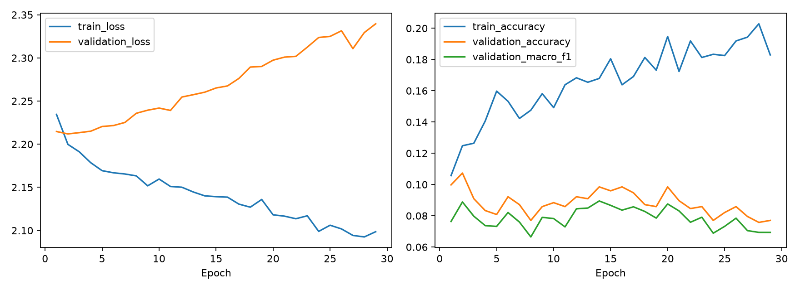
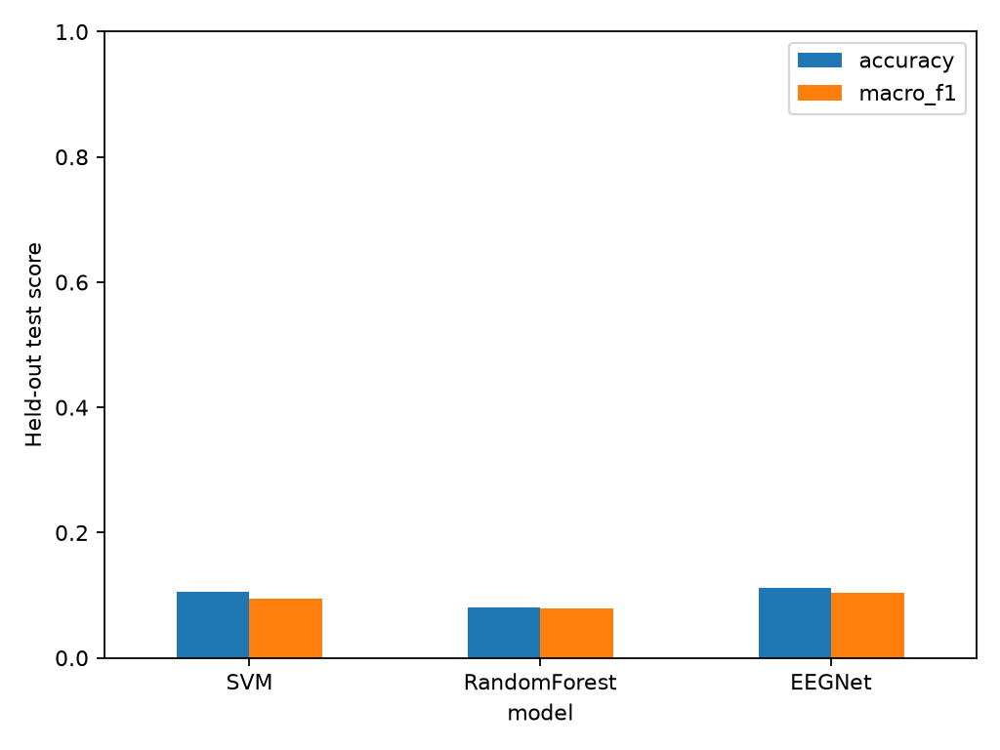
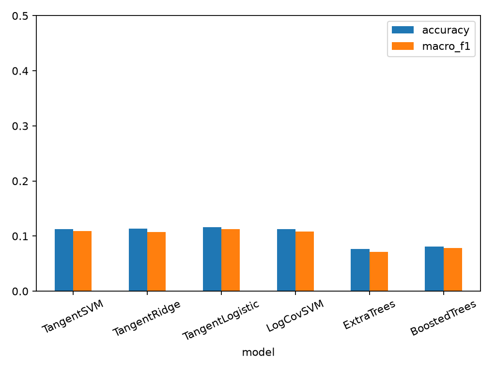
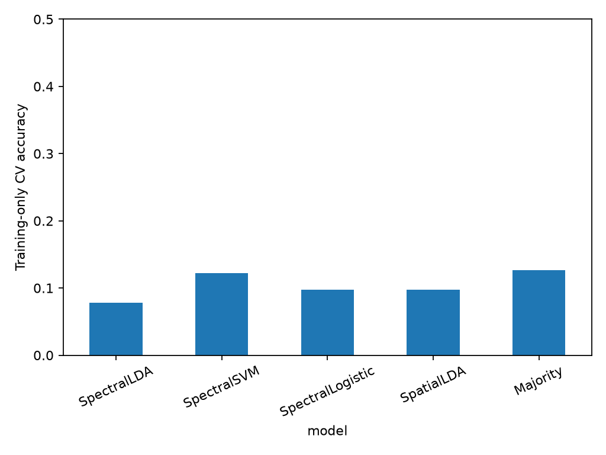
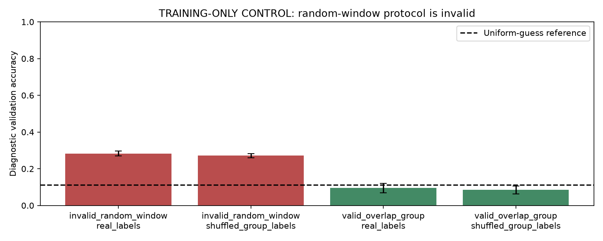
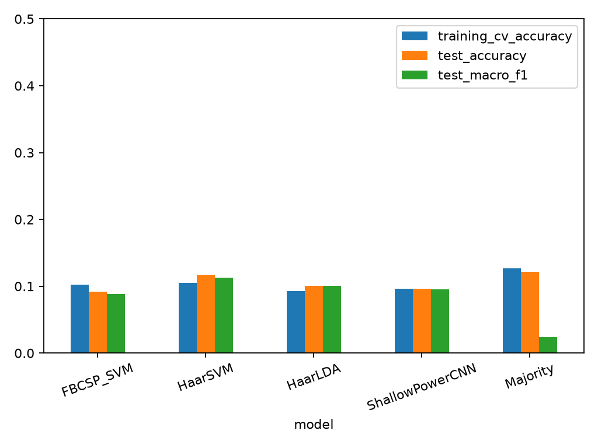
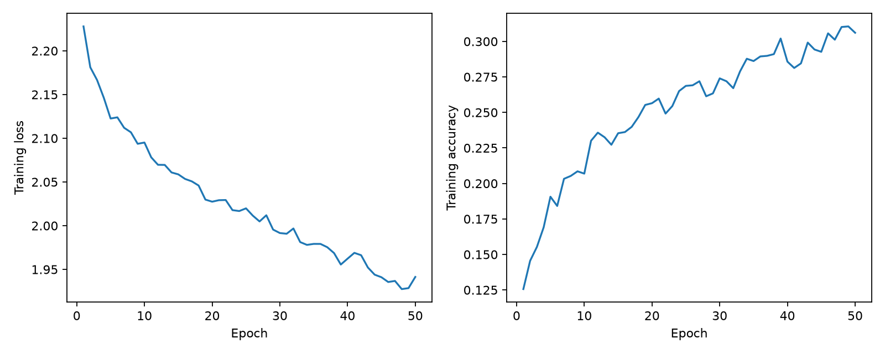
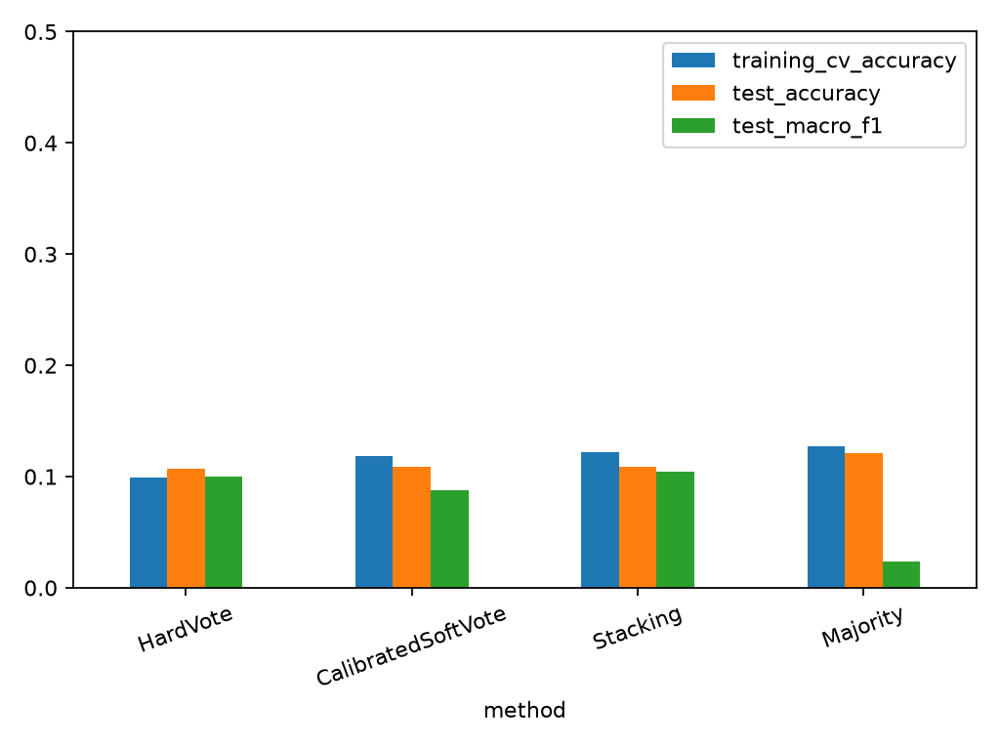

# EEGIS imagined-speech EEG classification

This project trains an RBF SVM, Random Forest, and compact EEGNet-style CNN on the locally supplied EEGIS version 1 archive. Experiments use real CSV signals; results are recorded by the training program.

## Dataset and provenance

Source: [EEGIS version 1, DOI 10.17632/73g4fw884c.1](https://data.mendeley.com/datasets/73g4fw884c/1), Edgar Lara, Andras Takacs, and Juvenal Rodríguez, CC BY 4.0. The source describes ten participants, Emotiv EPOC+, and 128 Hz sampling. The release contains raw signals plus delta, theta, alpha, beta, and gamma variants. Windows contain 128 time samples and 14 channels, with an exported row-index column. The source reports 48-sample overlap after trimming each state recording. Channel names are AF3, F7, F3, FC5, T7, P7, O1, O2, P8, T8, FC6, F4, F8, AF4.

The class mapping is 0 rest, 1 Ayuda, 2 Baño, 3 Dolor, 4 Gracias, 5 Hambre, 6 No, 7 Sed, 8 Sí. The observed raw counts by class 0–8 are 456, 504, 372, 492, 444, 444, 480, 408, and 444. The local archive SHA-256 and size are in `provenance.json`. The inspection report records actual CSV counts, shapes, ranges, and channel names. Every CSV in all six variants is checked for layout, numeric finite values, and index consistency. Only raw CSVs enter training; filtered copies are never treated as additional examples.

## Evaluation and leakage controls

The release provides class folders and numeric filenames, with no verified participant, session, or original trial identifiers. Numeric filenames are **not** interpreted as participant IDs. Consequently, the measured experiment is an overlap-component holdout, **not subject-independent testing**. Participants and sessions may appear in multiple partitions; these scores cannot establish performance on a new person.

For each raw window, the loader hashes its first and last 48 multichannel samples and its full content. Union-find joins matching windows globally, regardless of filename order or class folder. All windows in each connected component stay in one partition. A second audit rejects any identical 14-channel time sample crossing partitions. This prevents leakage of overlapping source samples and exact duplicated windows in the supplied data. It cannot recover unknown session/participant relationships.

Components are shuffled separately within each class with seed 42 and assigned approximately 60% training, 20% validation, 20% test. All classes must occur in every partition. The exact assignments are saved in `artifacts/manifest.csv`. No new overlapping windows are generated. No test examples are used for fitting scalers, hyperparameter search, early stopping, or model selection. Test examples are evaluated after the model selection decision has been frozen. Test scores are window-level; windows within a component remain correlated, so the window count is not an independent-trial count.

If verified participant metadata becomes available, supply a CSV with `path,subject_id`, where paths look like `raw/class_0/0.csv`. It must cover every raw file, and overlapping windows must agree on subject. `--subject-map participants.csv --out artifacts_subjects` switches to participant-group splits, keeps subjects disjoint across all partitions, and checks class coverage. No participant IDs were invented for the present experiment.

## Signal processing and models

Each window is independently demeaned per channel, then filtered with a fourth-order 0.5–40 Hz Butterworth bandpass using forward/backward filtering. Processing a single second limits low-frequency resolution and introduces edge effects; no continuous recording is available for improved filtering. No ICA or unsupported artifact-removal claim is made.

The baselines receive 238 features: for each channel, five log absolute and five relative Welch bandpowers (0.5–4, 4–8, 8–13, 13–30, 30–40 Hz), log variance, log mean squared first difference, Hjorth mobility and complexity, skewness, excess kurtosis, and peak-to-peak amplitude. Welch uses 128 samples (1 Hz bins); relative powers normalize across the five estimates. Band-edge bins are included in both adjacent bands. SVM features are standardized by a scaler fit on training data only. Random Forest uses unscaled features.

SVM searches C in {0.1, 1, 10, 100} and gamma in {scale, 0.001}. Random Forest searches maximum depth in {unlimited, 15} and minimum leaf size in {1, 3}, with 300 trees. Both use balanced class weights and validation macro-F1 for selection.

The CNN uses a temporal convolution (8 filters, kernel 33), depthwise spatial convolution (depth multiplier 2 across all channels), and a separable temporal convolution (kernel 17). Batch normalization, ELU, average pooling by 4 then 8, and dropout 0.35 precede a nine-class linear layer. This is a compact EEGNet-style implementation, not a claim of exact reference-code reproduction. Channel mean/std are fit on training windows only. Training uses class-weighted cross entropy, Adam (learning rate 0.001, weight decay 0.0001), batch size 64, at most 80 epochs, and early stopping after 15 epochs without validation macro-F1 improvement. The best validation checkpoint is restored. CPU operations are seeded and deterministic.

The overall saved winner is selected by validation macro-F1 across the three models. It is retained as trained on the training partition, allowing direct reproduction of its reported test predictions; there is no subsequent train+validation refit.

## Measured results

Measured on 792 held-out windows (66 complete overlap groups), using seed 42. Training used 2,460 windows (205 groups); validation used 792 windows (66 groups). All 24,264 CSVs were inspected; the six variants each contain 4,044 windows. All 337 raw overlap components contain exactly 12 windows.

| Model | Validation macro-F1 | Test accuracy | Test macro-F1 |
|---|---:|---:|---:|
| SVM | 0.0986 | 10.48% | 0.0939 |
| RandomForest | 0.1308 | 8.08% | 0.0798 |
| EEGNet | 0.0895 | 11.24% | 0.1034 |

The training-majority baseline achieved 12.12% accuracy and 0.0240 macro-F1. A uniform nine-class guess has expected accuracy 11.11%; this reference is analytical, not another measured model.

Random Forest had the highest validation macro-F1 and was saved as `artifacts/best_model.joblib` (300 trees, unlimited depth, minimum leaf size 1). SVM selected C=0.1 and gamma=scale. EEGNet achieved the highest observed test scores, but the test set was not used to change the validation-selected winner; its checkpoint is available at `artifacts/EEGNet.pt`. The mismatch between validation and test rankings illustrates uncertainty in this small grouped holdout.

EEGNet stopped after 29 epochs and restored epoch 14. The full experiment took 146.6 seconds on CPU, including inspection, fitting, and evaluation. These models show no useful classification performance on this holdout. They should not be described as a successful speech decoder. No extra tuning was performed after viewing test results during this initial experiment; the separate follow-up below was requested afterward.





The confusion matrices and per-class precision/recall/F1 are saved for every model. Reported macro-F1 is the unweighted average over all nine classes, including rest. No per-window random split or fabricated subject-independent score is reported.

## Reproduce

Run from this workspace with Python 3.14 (the measured environment):

```bash
python -m venv .venv
.venv/bin/python -m pip install -r requirements-lock.txt --extra-index-url https://download.pytorch.org/whl/cpu
MPLCONFIGDIR=/tmp/eegis-matplotlib .venv/bin/python -u -m eegis.train > experiment.log 2>&1
.venv/bin/python -m unittest discover -s tests -v
MPLCONFIGDIR=/tmp/eegis-matplotlib .venv/bin/python -m eegis.verify
```

`requirements-lock.txt` records the exact installed versions, including the CPU PyTorch build. `requirements.txt` lists direct dependencies for platforms that require different wheels. The dataset is expected in `EEGIS - Electroencephalogram Imagined Speech dataset/`. Keep the original directory layout; the dataset is not redistributed as project source.

To classify one correctly ordered raw window with the saved selected model:

```bash
.venv/bin/python -m eegis.predict 'EEGIS - Electroencephalogram Imagined Speech dataset/raw/class_0/0.csv'
```

Inference includes the same preprocessing and feature extraction, or saved CNN normalization. It returns a class ID/name; it does not estimate calibrated confidence.

## Outputs and source

- `eegis/data.py`: inspection, overlap reconstruction, splits, leakage audit, preprocessing, features.
- `eegis/models.py`, `eegis/train.py`: CNN, fitting, model selection, evaluation, plots.
- `eegis/predict.py`: saved-model inference.
- `tests/test_leakage.py`: overlap transitivity, rejection of leaking splits, grouped splitting, and feature/preprocessing invariance, and participant-map consistency.
- `artifacts/inspection.json`, `manifest.csv`, `leakage_audit.json`: dataset and partition audit.
- `artifacts/results.json`, `comparison.csv`: measured metrics, per-class reports, parameters, runtime, software versions.
- `artifacts/baseline_search.csv`, `selection.json`: all baseline candidates and validation selection.
- `artifacts/training_history.csv`, `training_curves.png`: CNN training and validation graphs.
- `artifacts/*_confusion.csv`, `*_confusion.png`, `comparison.png`: raw count matrices and comparison graphs.
- `artifacts/test_predictions.csv`: labels and predictions for every held-out window.
- `artifacts/SVM.joblib`, `RandomForest.joblib`, `EEGNet.pt`: all selected model checkpoints.
- `artifacts/best_model.*`, `best_model.json`: selected checkpoint and its input contract.

Validation: all four automated tests passed. `eegis.verify` reloads each checkpoint, compares every test prediction, recomputes accuracy/macro-F1, checks confusion counts and model selection, and verifies single-window inference. Its outcome is saved in `artifacts/verification.json`.

These are exploratory results from one fixed holdout split. More seeds and verified subject/session identifiers are needed for stronger generalization claims. Nine-class performance includes rest and should not be presented as eight-word-only accuracy.


## Accuracy improvement experiment

This follow-up preserves the original manifest exactly: 205 training, 66 validation, and 66 test overlap groups. Participant identities remain unavailable. The previously reported test set is reused, so these are exploratory follow-up results and require an untouched dataset for confirmation. No split seed was changed to obtain higher accuracy.

New spatial features use linearly detrended signals and five channel covariance matrices: broadband and 4–8, 8–13, 13–30, and 30–40 Hz. Each covariance matrix receives 10% shrinkage toward an isotropic matrix with matching trace. The training partition determines the covariance-whitening reference; symmetric matrix logarithms and upper-triangle vectorization yield 525 features. Trace normalization is tested both enabled and disabled. Log-covariance SVM omits reference whitening. Every fitted transform and scaler stays inside the cross-validation pipeline.

The search performed 159 fits across three stratified group folds inside the training partition. Each family first selects its hyperparameters by training cross-validation accuracy. The final candidate is selected by validation accuracy, with macro-F1 breaking ties, matching the request to improve accuracy. Candidates include tangent-space RBF SVM, ridge classification, tangent logistic regression, log-covariance RBF SVM, Extra Trees, and histogram gradient boosting. Tree candidates use the original 238 features. See the saved `*_cv.csv` files for all configurations and fold scores.

| New candidate | Training CV accuracy | Validation accuracy | Test accuracy | Test macro-F1 |
|---|---:|---:|---:|---:|
| TangentSVM | 9.11% | 9.47% | 11.24% | 0.1096 |
| TangentRidge | 10.08% | 10.48% | 11.36% | 0.1075 |
| TangentLogistic | 10.16% | 11.11% | 11.62% | 0.1126 |
| LogCovSVM | 9.51% | 9.72% | 11.24% | 0.1081 |
| ExtraTrees | 10.97% | 9.72% | 7.70% | 0.0716 |
| BoostedTrees | 10.42% | 8.96% | 8.08% | 0.0781 |

The new validation-selected candidate is **TangentLogistic**, with 11.11% validation accuracy and 11.62% test accuracy (macro-F1 0.1126). Its checkpoint is `artifacts_improved/best_model.joblib`. The original validation-selected Random Forest scored 8.08% on the same test windows; the new candidate's measured difference is +3.54 percentage points. The 95% paired overlap-group bootstrap interval for this difference is [-0.26, +6.94] points (5,000 resamples, 66 groups). This interval does not establish subject-independent improvement.

For context, the original EEGNet scored 11.24% test accuracy, and the training-majority predictor scored 12.12%. Compare against these as well as the original selected Random Forest. Low scores remain insufficient for a useful speech decoder; a small gain on a reused holdout should not be treated as a validated deployment result.

Across the original and new one-second models, validation accuracy recommends **RandomForest** from `artifacts`. This recommendation does not use test scores. The selected new model parameters are `{"model__C": 10, "spatial__normalize": false}`. The final resumed execution took 613.5 seconds on CPU; this excludes interrupted solver attempts and the earlier completed nonlinear SVM search. The original model files and results are preserved. Seven automated tests passed, including spatial-feature validity, inference independence, group aggregation, and amplitude invariance under trace normalization. `eegis.verify_improved` independently reloads all new models, recomputes predictions and metrics, checks the identical split, and verifies the selected-model inference path.



Reproduce and verify this experiment:

```bash
MPLCONFIGDIR=/tmp/eegis-matplotlib .venv/bin/python -u -m eegis.improve > improvement.log 2>&1
MPLCONFIGDIR=/tmp/eegis-matplotlib .venv/bin/python -m eegis.verify_improved
.venv/bin/python -m eegis.compare_runs
.venv/bin/python -m eegis.report_improved
.venv/bin/python -m eegis.predict --artifacts artifacts_improved "EEGIS - Electroencephalogram Imagined Speech dataset/raw/class_0/0.csv"
```

All new results, candidate hyperparameters, cross-validation details, confusion matrices, test predictions, checkpoint metadata, leakage audit, and verification results are under `artifacts_improved/`. The original CNN training curves remain in `artifacts/`; no new neural training is claimed in this follow-up.

### Optional longer-context decisions

A separate experiment averages class probabilities (or decision scores for models without probability output) across all 12 connected windows in a component. This uses 1,008 distinct raw samples, or 7.875 seconds, for one decision. Group membership comes from raw overlap matches; labels do not determine predictions. Entire components remain in their original partition. This is a different latency and evaluation unit from the one-second experiment, so its accuracy is not a direct one-second improvement.

The validation-selected context model is **ExtraTrees**: validation accuracy 13.64%; test accuracy **6.06%**, macro-F1 **0.0559** across 66 test components. The checkpoint is `artifacts_improved/best_context_model.joblib`, with aggregation metadata in `context_selection.json`. `context_test_predictions.csv` saves one prediction per component. Single-chain inference was checked against the recorded predictions.

Reproduce with `.venv/bin/python -m eegis.context`. To predict a new complete chain, run `.venv/bin/python -m eegis.context --predict <12 CSV paths>`; all windows must form one valid connected chain. The code rejects duplicates and incomplete or mixed chains. Re-run `eegis.report_improved` after this optional evaluation to refresh these measured results.


## Reconstructed-recording experiment and leakage diagnosis

Work branch: `experiment/reconstructed-recordings`. The original one-second experiments and their results are preserved. This experiment reconstructs each overlap component into a continuous 1,008-sample recording (7.875 seconds). It differs from the earlier context experiment, which averaged predictions from separately processed windows.

All 337 components were reconstructed using exact 48-sample prefix/suffix matches, without filenames or labels determining window order. Every original window is reproduced exactly at its recovered offset. Duplicate, missing, mixed, ambiguous, or cyclic chains are rejected. The audit found 0 identical multichannel samples crossing partitions. The same 205/66/66 training/validation/test components are retained. Participant identities are still unavailable.

Continuous processing may reduce the relative influence of one-second filtering boundaries and allows a 256-sample Welch segment (0.5 Hz bins). Spectral features comprise five log absolute and five relative bandpowers per channel, log variance, Hjorth mobility/complexity, and spectral entropy: 196 features. Band energy sums use half-open frequency intervals, avoiding shared band-edge bins. Signals are detrended and filtered per recording. Common-average referencing is tested both enabled and disabled.

Spatial features use six regularized channel covariance matrices (broadband plus the five EEG bands), followed by training-fitted covariance whitening, matrix logarithms, and scaling: 630 features. The models are shrinkage LDA, PCA + RBF SVM, logistic regression, and spatial shrinkage LDA. All fitted steps stay inside the cross-validation pipelines.

The search used 72 model fits in three-fold cross-validation on the 205 training recordings, plus the majority baseline. Family and hyperparameter selection use training CV accuracy, with macro-F1 breaking family ties. Validation and test scores do not choose the winner. Only the frozen winner and the training-majority baseline are evaluated on the held-out partitions. The test split was previously reported, so this remains exploratory.

| Candidate | Training CV accuracy | Training CV macro-F1 |
|---|---:|---:|
| SpectralLDA | 7.82% | 0.0753 |
| SpectralSVM | 12.20% | 0.0310 |
| SpectralLogistic | 9.76% | 0.0925 |
| SpatialLDA | 9.77% | 0.0918 |
| Majority | 12.69% | 0.0250 |

**Selected: Majority.** Validation accuracy is 12.12%; test accuracy is 12.12%, macro-F1 0.0240, across 66 recordings. The training-majority test baseline is 12.12%. None of the learned candidates beats the majority baseline in training CV. The selected constant predictor is saved for reproducibility; this is not an accuracy improvement or a usable imagined-speech decoder.

The recording experiment took 69.4 seconds on CPU. `artifacts_epochs/reconstruction_audit.json` records the source-manifest checksum and exact reconstruction checks. `verification.json` confirms replayed reconstruction, unchanged partitions, reloaded predictions, recomputed metrics and confusion counts, training-only selection, and inference from reversed input-window order. The saved model is `artifacts_epochs/best_model.joblib`; its input contract is in `best_model.json`.



### Training-only leakage controls

These deliberately include an invalid random-window protocol to diagnose inflated scores. They are not held-out test performance and must not be used as claimed system accuracy. The original validation and test partitions are excluded completely. A fixed 300-tree Random Forest uses the original 238 features. Seeds 42, 43, and 44 produce three 80/20 splits inside the original training partition; the group-safe and random-window controls each train on 1,968 windows and evaluate on 492.

For the shuffled control, labels are permuted between the 205 recording groups and remain consistent across every window of a group. This removes the original word-to-recording label assignment while retaining opportunities to recognize a recording. Both protocols are rerun on those arbitrary group labels.

| Protocol | Target labels | Diagnostic accuracy, mean ± SD | Diagnostic macro-F1 |
|---|---|---:|---:|
| invalid_random_window | real_labels | 28.25% ± 1.33% | 0.2823 |
| invalid_random_window | shuffled_group_labels | 27.17% ± 1.12% | 0.2637 |
| valid_overlap_group | real_labels | 9.49% ± 2.59% | 0.0953 |
| valid_overlap_group | shuffled_group_labels | 8.47% ± 2.08% | 0.0851 |

The invalid random-window scores remain elevated after group labels are shuffled. This is evidence that shared samples and recording-specific structure can inflate accuracy without useful word classification. The valid group controls have zero shared multichannel samples; the invalid controls expose most diagnostic holdout windows to training samples. The standard deviations describe three repeated splits of the same training data, not confidence intervals. These controls do not prove that the dataset contains no speech information.



Every diagnostic prediction is saved in `artifacts_diagnostics/diagnostic_predictions.csv`. The independent verification script regenerates the internal split indices, checks group-label permutations, recomputes exact sample-overlap counts, and recomputes the metrics and summary from those predictions. No control model is promoted or saved as a speech classifier.

Reproduce this branch work:

```bash
MPLCONFIGDIR=/tmp/eegis-matplotlib .venv/bin/python -u -m eegis.epochs > epochs.log 2>&1
MPLCONFIGDIR=/tmp/eegis-matplotlib .venv/bin/python -m eegis.verify_epochs
MPLCONFIGDIR=/tmp/eegis-matplotlib .venv/bin/python -u -m eegis.diagnose_leakage > leakage_diagnostic.log 2>&1
.venv/bin/python -m eegis.verify_diagnostics
.venv/bin/python -m eegis.report_epochs
.venv/bin/python -m unittest discover -s tests -v
```

Single-recording inference is available as `.venv/bin/python -m eegis.epochs --predict <12 CSV paths>` and rejects invalid chains. All 11 automated tests pass. Source, small CSV/JSON reports, figures, and audit files are shareable; raw signals, virtual environments, and binary checkpoints remain excluded from Git.

The next useful step is to obtain verified participant/session/trial identifiers and establish an untouched evaluation set before making stronger generalization claims. Further tuning against the already reported holdout risks choosing noise. The existing nine-class task includes rest; reducing the class set would be a different experiment and must be labeled separately.

Related primary research: the dataset authors’ [Feature Generation with Genetic Algorithms for Imagined Speech Electroencephalogram Signal Classification](https://doi.org/10.3390/eng6040075) discusses recognizing Sí and No and describes full-vocabulary EEGIS as future work. Compare published results only after matching the label set, channels, feature-selection procedure, and split protocol. This nine-class experiment is not a reproduction of that binary study.


## Alternative one-second techniques

This attempt returns to the original nine-class, one-second task. The original manifest, seed, and 2,460/792/792 training/validation/test windows are retained. All overlap groups remain intact in outer partitions and training CV folds.

The search space is recorded before fitting in `artifacts_alternatives/plan.json`. New methods:

- **Filter-bank CSP + SVM:** supervised one-vs-rest spatial filters are fitted independently for each of the five EEG bands. Each class covariance is compared against the mean of the other class covariances, with 10% isotropic shrinkage. The smallest/largest generalized eigenvectors provide one or two filter pairs. Log relative projected variances are ranked with training-only ANOVA feature selection (20 or 50 selected), standardized, and passed to an RBF SVM. Channel reference and C are chosen inside training group CV. CSP fitting, feature selection, and scaling never see a held-out fold.
- **Haar features + SVM/LDA:** six-level orthonormal Haar decomposition gives seven coefficient groups. Log energy, relative energy, and normalized coefficient entropy yield 294 channel features. Features are averaged across four circular shifts to reduce phase sensitivity. Windows are independently detrended and bandpass filtered; common-average referencing is tested enabled/disabled. The classifiers use training-fitted scaling with RBF SVM or automatically shrunk LDA.
- **Shallow power CNN:** temporal and spatial convolutions, batch normalization, squaring, full-window average pooling, a safe logarithm, dropout, and a nine-class head learn power-based features. Per-window channel normalization avoids learned population statistics. Training-only time shifts, channel gains, and noise provide augmentation. AdamW trains for a fixed 50 epochs (learning rate 0.0008, weight decay 0.01, batch size 64, dropout 0.5, class-weighted loss with label smoothing 0.05). Neither fold scores nor holdout scores select checkpoints.

The experiment performs 78 training-only grouped CV fits, followed by a full-training refit for each family. The CNN has one prespecified configuration and completes the same fixed-duration procedure in each fold. Family selection uses mean training CV accuracy, with macro-F1 breaking family ties. All configurations and the overall winner are frozen before validation/test predictions are generated. The previously reported holdout is reused, so these results are exploratory rather than independent confirmation.

| Technique | Training CV accuracy | Validation accuracy | Test accuracy | Test macro-F1 |
|---|---:|---:|---:|---:|
| FBCSP_SVM | 10.21% | 9.09% | 9.22% | 0.0885 |
| HaarSVM | 10.49% | 10.48% | 11.74% | 0.1130 |
| HaarLDA | 9.31% | 9.22% | 10.10% | 0.1008 |
| ShallowPowerCNN | 9.63% | 8.71% | 9.60% | 0.0953 |
| Majority | 12.68% | 12.12% | 12.12% | 0.0240 |

The training-CV-selected winner is **Majority**: test accuracy **12.12%**, macro-F1 **0.0240**. The majority baseline scores 12.12% accuracy and 0.0240 macro-F1. The highest observed learned-model test accuracy belongs to HaarSVM (11.74%); test ranking does not change the frozen model selection.

Do not treat a small gain on a reused holdout as a confirmed improvement. Participant identities remain unavailable, and scores do not establish generalization to unseen people. The best prior learned one-second test accuracy was 11.62%; compare against the majority baseline as well. The earlier intentionally invalid random-window control is not used for training selection or performance claims here.

The run took 433.0 seconds on CPU. All five fitted models are saved locally, together with the selected checkpoint `artifacts_alternatives/best_model.joblib` and its input contract. The checkpoint contains a complete raw-window pipeline, so inference applies the matching CSP, wavelet, or neural processing. All 16 automated tests pass. Independent verification reloads every model, reproduces every validation and test prediction, recomputes metrics/confusion matrices, checks group disjointness, and verifies single-window inference.





Reproduce:

```bash
MPLCONFIGDIR=/tmp/eegis-matplotlib .venv/bin/python -u -m eegis.train_alternatives > alternatives.log 2>&1
MPLCONFIGDIR=/tmp/eegis-matplotlib .venv/bin/python -m eegis.verify_alternatives
.venv/bin/python -m eegis.report_alternatives
.venv/bin/python -m unittest discover -s tests -v
.venv/bin/python -m eegis.predict --artifacts artifacts_alternatives "EEGIS - Electroencephalogram Imagined Speech dataset/raw/class_0/0.csv"
```

Source: `eegis/alternatives.py`, `train_alternatives.py`, `verify_alternatives.py`, and `report_alternatives.py`. Measured CV results, fold membership, predictions, metrics, confusion matrices, training history, and verification are in `artifacts_alternatives/`. Dataset files, binary checkpoints, and logs remain local. Work is kept on `experiment/reconstructed-recordings`; main is not changed.

No learned candidate beat the majority baseline in training CV. The selected constant predictor is a reference, not a usable speech decoder. No successful accuracy improvement is claimed.

The power CNN reached 30.61% training accuracy on augmented batches, while its grouped CV accuracy was 9.63% and test accuracy was 9.60%. Better fitting of training recordings did not transfer to held-out recordings in this run.

Paired recording-group bootstrap (5,000 resamples, descriptive uncertainty on the reused holdout):

Against previous_TangentLogistic, the frozen winner differs by +0.51 percentage points, with a 95% interval of [-6.57, +8.71] points. These intervals are not used to select a model and do not establish subject-independent improvement.

Against majority, the frozen winner differs by +0.00 percentage points, with a 95% interval of [+0.00, +0.00] points. These intervals are not used to select a model and do not establish subject-independent improvement.


## Group-safe ensemble experiment

This experiment combines the four previously trained one-second learners: FBCSP SVM, Haar SVM, Haar shrinkage LDA, and the power CNN. Their previously selected training hyperparameters are frozen. No original validation or test labels enter calibration, stacking, vote tie-breaking, or ensemble selection. The original nine-class split remains unchanged.

Three ensemble methods are compared:

- **Hard voting:** each base model supplies one class vote. Training class priors resolve vote ties; remaining exact ties use fixed class order.
- **Calibrated soft voting:** each member’s score vector is converted to nine-class probabilities by a scaler + multinomial logistic-regression calibrator (C=0.1), fitted on group-excluded predictions. Member probabilities are averaged equally. SVM decision scores are used without enabling built-in probability fitting. The learned probability mapping does not by itself guarantee well-calibrated confidence.
- **Stacking:** a scaler + logistic-regression meta-classifier (C=0.1) learns from the concatenated 36 base scores, using group-excluded predictions. It never receives the base learners’ in-sample predictions.

A nested training-group procedure prevents a second layer of leakage: three outer folds assess each ensemble, and two inner folds produce meta-training predictions entirely within each outer training partition. The outer held-out groups are excluded from every inner fit and prediction set. A separate full outer-training base fit predicts the outer held-out fold. There are 36 base-model fits in total, including nine fixed 50-epoch CNN fits. No epoch or ensemble weight is tuned on the holdout.

The three outer base predictions also form one out-of-group score row for every original training window. After ensemble selection by pooled outer-fold accuracy (macro-F1 tie-break), those rows fit the final calibrators and stacker. The already fitted full-training base checkpoints are reused for validation/test inference and checked by SHA-256. This nested procedure guards meta-feature fitting, but the base hyperparameters were previously selected on this training partition, so CV remains a model-selection estimate. The original test set was already reported; these are exploratory follow-up results.

| Method | Nested training CV accuracy | Validation accuracy | Test accuracy | Test macro-F1 | Test classes predicted |
|---|---:|---:|---:|---:|---:|
| HardVote | 9.88% | 8.96% | 10.73% | 0.0996 | 9 |
| CalibratedSoftVote | 11.87% | 10.35% | 10.86% | 0.0881 | 9 |
| Stacking | 12.15% | 11.49% | 10.86% | 0.1046 | 9 |
| Majority | 12.68% | 12.12% | 12.12% | 0.0240 | 1 |

The frozen CV-selected method is **Majority**, with 12.12% test accuracy and 0.0240 macro-F1. The highest observed ensemble test accuracy is CalibratedSoftVote (10.86%); observing the test ranking does not change the selected method. The previous best learned one-second result was Haar SVM at 11.74%, while the training-majority reference scores 12.12%. A method predicting only one class is a reference-level result rather than useful word recognition.

Member disagreement, joint errors, and error correlations are measured from the group-excluded base predictions in `diversity.csv`. These are descriptive measures on correlated EEG windows, not independent significance tests. Diversity alone does not establish that members carry useful word information. This experiment does not establish subject-independent performance.

Runtime: 283.6 seconds on CPU. All 19 automated tests pass. `fit_audit.json` records the fit, prediction, and forbidden groups for every base fit. Independent verification checks all 36 fits, inner/outer role assignments, reconstructed meta-models from OOF scores, source-checkpoint hashes, every held-out prediction/metric, confusion counts, selection, and one-window inference.



Reproduce after generating the base checkpoints with `eegis.train_alternatives`:

```bash
MPLCONFIGDIR=/tmp/eegis-matplotlib .venv/bin/python -u -m eegis.ensemble > ensemble.log 2>&1
MPLCONFIGDIR=/tmp/eegis-matplotlib .venv/bin/python -m eegis.verify_ensemble
.venv/bin/python -m eegis.report_ensemble
.venv/bin/python -m unittest discover -s tests -v
.venv/bin/python -m eegis.predict --artifacts artifacts_ensembles "EEGIS - Electroencephalogram Imagined Speech dataset/raw/class_0/0.csv"
```

The selected checkpoint (`artifacts_ensembles/best_model.joblib`) bundles full base learners, calibrators, stacker, prior, and frozen method. Its `predict_all` method exposes all four comparisons. Binary checkpoints and the derived OOF score matrix are kept local; regenerate training outputs before running verification after cloning. Small reports, group assignments, OOF labels/predictions, confusion matrices, and plots are shareable. Work stays on `experiment/reconstructed-recordings`; main is unchanged.

None of the three learned ensembles beats the majority reference in nested training CV. No successful accuracy improvement is claimed.


## Binary paper-method reproduction

A separate **Sí/No-only** implementation follows the paper's 214-feature-per-channel and 228-bit genetic-search design. The test uses **50 GA generations**, not neural epochs. See [the detailed binary report](artifacts_paper_binary/README.md) for assumptions, hardware, commands, and leakage audits.

| Protocol | Model | Fitness validation accuracy | Test accuracy | Test macro-F1 | Majority test accuracy |
|---|---|---:|---:|---:|---:|
| grouped | knn | 78.47% | 43.33% | 0.4322 | 53.33% |
| paper-window | knn | 87.16% | 62.16% | 0.6215 | 51.89% |

The grouped score is exploratory. The window-split score knowingly shares EEG samples across partitions and is **diagnostic only**. Neither establishes subject-independent performance. The paper's 96% is not claimed as a reproduced result. The executed device is cpu; CUDA-capable code is provided, but GPU execution could not be tested on this host.


## Author-source 96% reproduction attempt

Recovered the author's Signalytica functions and exact NumPy/SciPy pins in an isolated Python 3.10 environment. Ran three 100-generation, 100-genome searches and eight fixed published-mask checks. The previous 50-generation implementation is retained. See [the full reproduction report](artifacts_author_reproduction/README.md).

| Protocol | Fitness accuracy | Test accuracy | Test macro-F1 | Majority test accuracy |
|---|---:|---:|---:|---:|
| grouped | 82.64% | 46.67% | 0.4664 | 53.33% |
| grouped / within-window scaling | 82.64% | 51.67% | 0.5159 | 53.33% |
| paper-window | 93.24% | 61.62% | 0.6162 | 51.89% |

The paper's 96% was not reproduced on the grouped test. Window-split scores are leakage diagnostics; fitness is not independent test accuracy. Original test reuse and missing subject IDs remain limitations. Unpublished author settings prevent a complete 1:1 claim.
