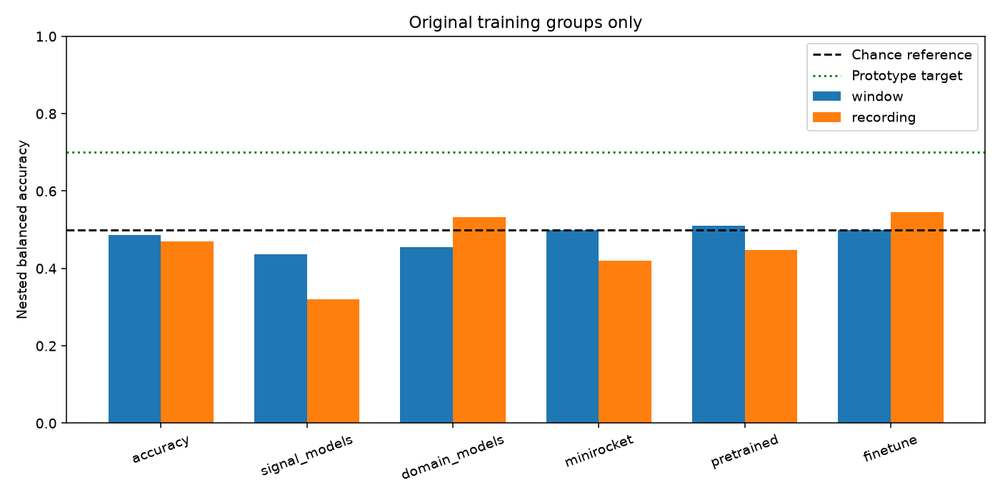
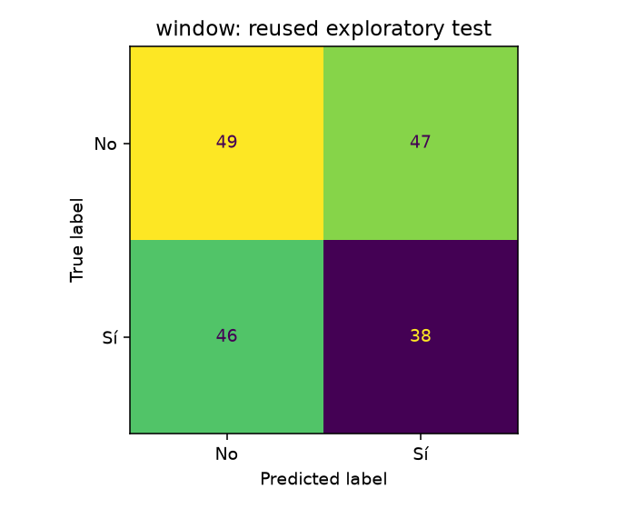
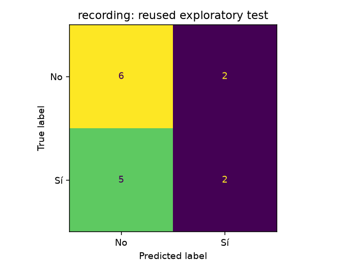

# Accuracy-improvement research: target not reached

Six exploratory batches tested **242 hyperparameter configurations** with training-only nested grouping. Methods included random temporal convolutions, covariance/tangent models, CSP, spectral/spatial contrasts, phase connectivity, CNNs, latent alignment, reference MiniRocket, frozen LaBraM and last-block adaptation. No batch met the declared prototype gate.

The best observed nested balanced accuracy was **54.62%**, below the 70% target. These are repeated exploratory comparisons on the same training groups; this maximum is not an independent estimate of a cross-study selection procedure.

## Separately frozen final refit

For each input duration, the candidate with the highest original-training inner-CV balanced accuracy was selected, with macro-F1 and declared order breaking ties. The complete selection was saved before any new test prediction. Models were then refitted on the original training plus validation partitions (62 overlap components) and evaluated once on the previously reported test set (15 components). All training-only study checkpoints are preserved.

| Input duration | Test accuracy | Balanced accuracy | Macro-F1 | Majority accuracy | Approximate balanced-accuracy interval |
|---|---:|---:|---:|---:|---:|
| 1 seconds | 48.33% | 48.14% | 0.4814 | 53.33% | 39.43%–58.04% |
| 7.875 seconds | 53.33% | 51.79% | 0.4976 | 53.33% | 28.57%–75.00% |

The majority balanced-accuracy reference is 50%. **These are not passable decoder results.** The primary saved model is the predeclared one-second model, regardless of which duration scored higher. No test score selected its source method, parameters, seed, normalization or input duration.

The one-second winner is `car_ridge` from artifacts_accuracy; the longer-context winner is `relative_spectrum_ridge` from artifacts_domain_models.

## What the data support

The release reconstructs into only 77 No/Sí overlap components, with 47 in the original training partition. These are not verified complete trials or participants. Window counts include correlated observations. The release has no verified participant/session identifiers, so subject-independent accuracy cannot be measured. Every example appeared in earlier research, and all follow-up scores remain exploratory.

A separate training-only diagnostic tested spectral, spectral-shape, topographic, phase and raw-offset representations with 999 class-label permutations. None showed significant kernel class separation after Holm correction. This limited diagnostic does not prove that the data lack information or that labels are incorrect. Synthetic controls confirm the algorithms can learn clean frequency/spatial patterns, but those controls are not EEGIS performance measurements.

The useful next input is more labeled recordings and verified participant/trial metadata, followed by a genuinely untouched evaluation. Further trials on these same development splits cannot establish a reliable 70% decoder. No claimed success or fabricated metric replaces the negative results.

## Verification and reuse

Each research batch independently refits selected inner and outer models, checks group boundaries and recomputes all saved predictions and metrics. The final refit has a second independent fit for each duration and exact checkpoint/raw-inference checks. Earlier measurement files remain unchanged. Approximate intervals resample complete overlap components; they do not certify participant independence or account for all adaptive research choices.

The final model files remain local under window/best_model.joblib and recording/best_model.joblib. The root best_model.joblib is the predeclared one-second model. To classify one original raw CSV:

```bash
.venv/bin/python -m eegis.predict_accuracy "EEGIS - Electroencephalogram Imagined Speech dataset/raw/class_6/0.csv"
```

Use --unit recording with twelve overlapping raw CSVs to classify a reconstructed component. This is a longer-context decision, not a one-second score.

Full study reports: [artifacts_accuracy](../artifacts_accuracy/README.md), [artifacts_signal_models](../artifacts_signal_models/README.md), [artifacts_domain_models](../artifacts_domain_models/README.md), [artifacts_minirocket](../artifacts_minirocket/README.md), [artifacts_pretrained](../artifacts_pretrained/README.md), [artifacts_finetune](../artifacts_finetune/README.md).






