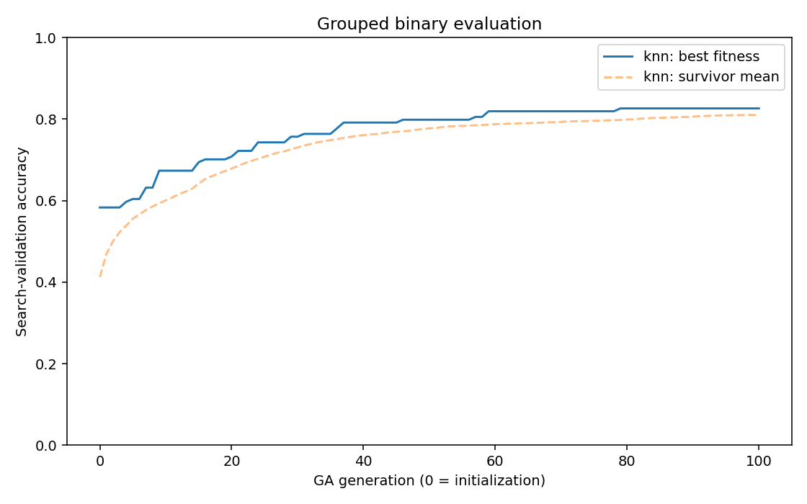
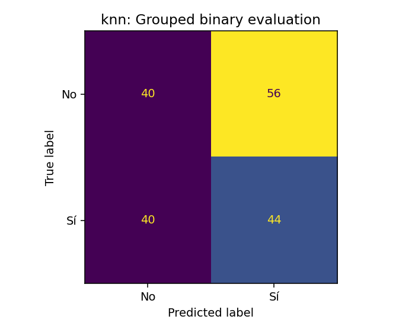
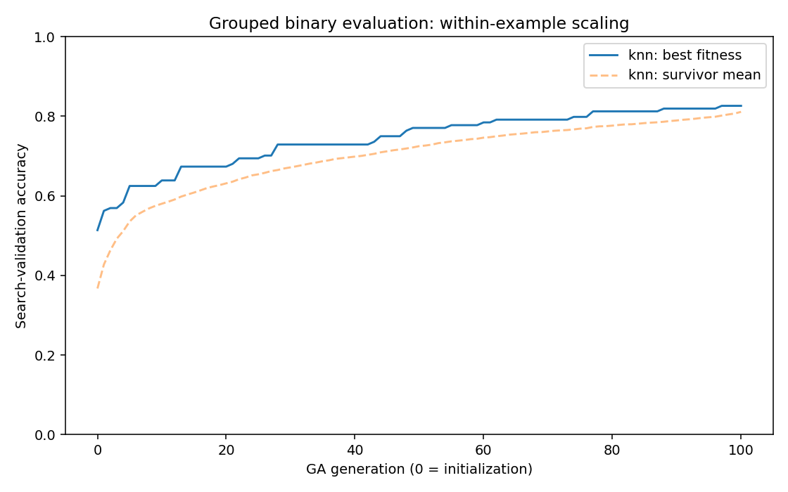
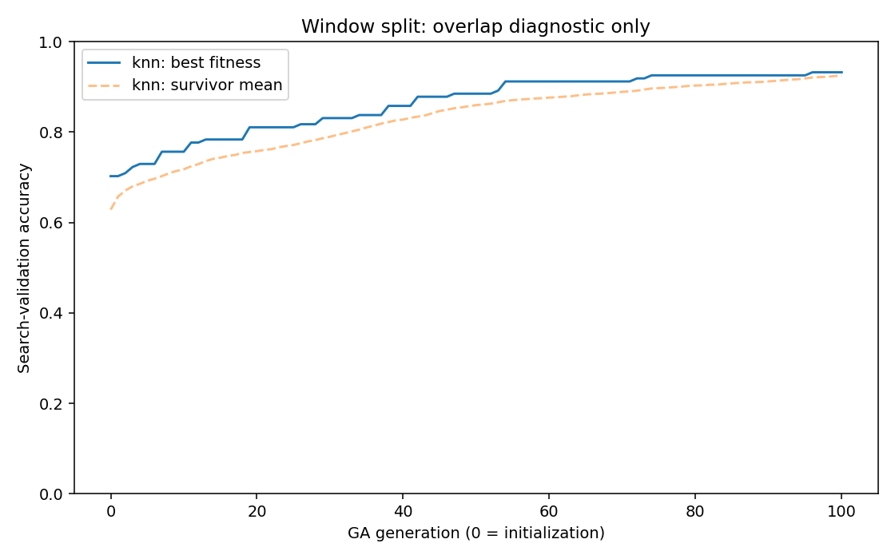

# Author-source reproduction attempt

This experiment attempts the 96% binary accuracy reported by [Lara-Arellano et al.](https://doi.org/10.3390/eng6040075). It preserves earlier results and uses only No (class 6) and Sí (class 8).

## Recovered source and environment

The paper spells the feature library "signalityca". The author's [thesis](https://ri-ng.uaq.mx/bitstream/123456789/12198/1/IGMAC-320366.pdf) identifies [Signalytica](https://pypi.org/project/signalytica/). Its [public source](https://github.com/Edgar-La/signalytica) supplies concrete functions that differ from the paper equations. The exact installed source hash is in feature_spec.json.

Signalytica 0.1.20 declares NumPy 1.21.6 and SciPy 1.7.3. An isolated **Python 3.10** environment uses these exact two pins. AntroPy 0.1.9 and scikit-learn 1.6.1 are explicit compatible paper-era choices; the paper does not identify their exact original versions. See requirements-author.txt and requirements-author-lock.txt. Both the main and isolated environments pass dependency checks. The old library is isolated rather than forcing old NumPy/SciPy onto Python 3.14.

| Detail | Author implementation retained |
|---|---|
| Coefficient variation | Returns variance |
| Hjorth activity | Returns variance |
| Mode | First occurrence wins ties |
| Power spectrum | Welch, 128 Hz, 128 samples, Hann window, constant detrending |
| Recurrence | Scalar differences, identity diagonal included, source suffix-count convention |
| Band amplitude | Matching-band filter followed by RMS |
| Relative band power | Inclusive Welch integral divided by same-input 0.5–100 Hz integral |
| Complexity functions | Exact AntroPy calls shown in commented source, including normalization flags |

Vectorized recurrence and statistical calculations are tested against the installed author functions. No corrected textbook formula silently replaces an unusual author implementation. The six original supplied signal layers are used directly. The feature bank is 14 × 214: 34 raw values and 36 values per filtered band.

## Published genome checks

The 228-bit genome is transcribed from Section 3. It selects AF3, T7, O1, O2, P8, T8, F4, F8 and 103 feature positions. These yield 824 flattened values. Table 2 row activations agree with the feature order. Its bottom theta/alpha counts appear swapped: the genome yields 16/14, not 14/16.

The paper states both k=7 and k=9, and both 80/20 and 20/80 split proportions. The following fixed checks report all declared cases, with seed 42. The global-scaler case tests a possible interpretation of standardization before splitting. **These are diagnostics:** the published feature mask may already have used all released data. Window splits additionally share EEG samples; global scaling also uses held-out statistics. No case is selected as a winner using its test score.

| Fixed-mask case | k | Fit/test windows | Accuracy | Macro-F1 | Shared test windows |
|---|---:|---:|---:|---:|---:|
| grouped | 7 | 744/180 | 45.56% | 0.4522 | 0 |
| grouped | 9 | 744/180 | 46.11% | 0.4583 | 0 |
| window_80_20 | 7 | 739/185 | 62.70% | 0.6249 | 165 |
| window_80_20 | 9 | 739/185 | 60.54% | 0.6016 | 165 |
| window_20_80 | 7 | 184/740 | 53.51% | 0.5316 | 243 |
| window_20_80 | 9 | 184/740 | 54.32% | 0.5378 | 243 |
| window_80_20_global_scaling | 7 | 739/185 | 60.54% | 0.6024 | 165 |
| window_80_20_global_scaling | 9 | 739/185 | 61.08% | 0.6082 | 165 |

## Full genetic searches

The three runs use **100 generations**, plus initialization, with **100 genomes**. Each chromosome has 14 channel bits and 214 feature bits. Rank-weighted mating, uniform crossover, bit-flip mutation and parent-plus-offspring survival are used. The paper does not state the crossover/mutation probabilities or random seed; p=0.5 crossover bits and mutation 1/228 are declared implementation choices.

kNN searches {5,7,13,15,17,21,37} for every genome. The optimized evaluator is tested against the original sklearn-metric evaluator. Fitness labels belong only to an inner validation partition. Neither outer test features nor outer test labels enter the search. Selection is frozen before refitting the training scaler and classifier on outer training windows. There is no target-based stopping or seed search.

A third, predeclared grouped run resolves a textual ambiguity: standardization before flattening may mean z-scoring each feature column across selected electrodes within each example. This variant has no population-scaler statistics. Its addition was recorded before either first full-run test score was inspected. It uses the same frozen outer and inner group assignments. The two grouped interpretations are compared by inner fitness only, and all test scores are reported.

The within-example variant uses actual scikit-learn scaling and an independent prediction for each k. Two-electrode masks produce many distance ties. A preliminary Torch-neighbor implementation failed parity (9 of 180 predictions differed) and was rejected before reporting any test metric. The corrected variant reran all 100 generations; the incomplete run is archived locally. A two-electrode tie regression test checks exact sklearn prediction parity. This variant uses CPU to preserve the reference library's tie behavior.

All numerical thread pools are fixed at four threads. Reference predictions repeat at that setting. Thread count can affect equal-distance selection in sklearn; the author's original setting is unknown. It is not searched using accuracy.

| Protocol | Fitness accuracy | Test accuracy | Test macro-F1 | Majority test accuracy | Selected k |
|---|---:|---:|---:|---:|---:|
| grouped | 82.64% | 46.67% | 0.4664 | 53.33% | 15 |
| grouped / within-window scaling | 82.64% | 51.67% | 0.5159 | 53.33% | 7 |
| paper-window | 93.24% | 61.62% | 0.6162 | 51.89% | 5 |

**Outcome:** The paper's 96% was not reproduced on the grouped test.

The window-split number is an overlap-contaminated diagnostic, not valid decoder accuracy. Fitness accuracy is adaptively optimized and is not independent test performance. The original grouped test has been used before; new scores remain exploratory. Participant identifiers are unavailable, so subject-independent testing is not established.

## Remaining reproduction limits

The complete author GA/training program and exact split indices were not located. The public Signalytica package comments out eight AntroPy methods; this code restores the shown calls. The original AntroPy/sklearn versions, feature assembly details and GA rates remain unspecified. Thus, source behavior and two dependency pins are recovered, but a complete numerical 1:1 claim is not justified. No authors or teammates were messaged.

## Reproduce

```bash
python3.10 -m venv .venv-paper
.venv-paper/bin/python -m pip install --extra-index-url https://download.pytorch.org/whl/cpu -r requirements-author.txt
NUMBA_CACHE_DIR=/tmp/eegis-numba-paper MPLCONFIGDIR=/tmp/eegis-matplotlib-paper .venv-paper/bin/python -u -m eegis.author_reproduction --generations 100 --population 100 > author_reproduction.log 2>&1
NUMBA_CACHE_DIR=/tmp/eegis-numba-paper MPLCONFIGDIR=/tmp/eegis-matplotlib-paper .venv-paper/bin/python -u -m eegis.author_window_scaling --generations 100 --population 100 > author_window_scaling.log 2>&1
NUMBA_CACHE_DIR=/tmp/eegis-numba-paper .venv-paper/bin/python -m eegis.verify_author_reproduction
.venv-paper/bin/python -m eegis.report_author_reproduction
.venv-paper/bin/python -m unittest discover -s tests -p test_author_reproduction.py -v
.venv-paper/bin/python -m eegis.predict_author --window class_8/0.csv
```

Use the isolated environment for the new checkpoints. The best_model.joblib accepts a complete six-layer example through predict_layers; predict_author loads matching supplied CSVs automatically. The original raw-only predictor is not used for this checkpoint. Torch kNN retains CPU/CUDA/auto support, but the measured environment is CPU-only. No GPU result is claimed.









Checkpoints, feature caches and complete population states stay local. Manifests, plans, masks, fitness tables, predictions, scores, plots and verification are shareable.
