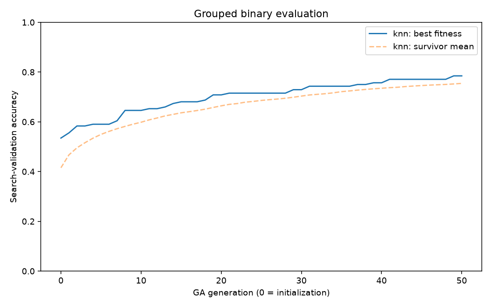
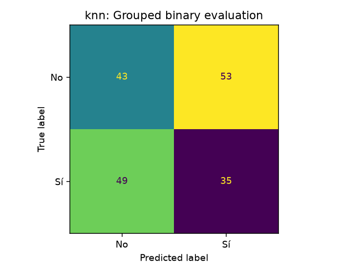

# Binary paper-method reproduction

Source: Lara-Arellano et al., *Feature Generation with Genetic Algorithms for Imagined Speech Electroencephalogram Signal Classification*, Eng 2025, 6, 75. [Paper](https://doi.org/10.3390/eng6040075).

This experiment uses only **No (original class 6)** and **Sí (original class 8)**. It loads 924 original one-second windows, representing 77 exact-overlap groups. It does not train on the reconstructed 7.875-second segments.

The paper uses a genetic algorithm, not a neural epoch loop. The smoke run uses 50 GA generations, plus initialization at generation 0, with 100 genomes. The smoke run tests kNN. The pipeline also supports a separate search for each of the ten paper classifiers. The ten-classifier comparison has not been run unless those names appear in results.json.

Each raw window produces 14 × 214 values: 34 raw features and 36 features from each of five bands. A 228-bit genome contains 14 channel bits and 214 shared feature bits. Selected channel-feature matrices are flattened. StandardScaler is fitted only on the current fitting partition. kNN searches k in {5, 7, 13, 15, 17, 21, 37} for every candidate. Rank-weighted mating, uniform bit crossover, bit-flip mutation at 1/228, and top-100 survival implement the search.

**This is a transparent implementation of the stated method, not a claim of an exact numerical 1:1 reproduction.** The paper gives conflicting split ratios and kNN settings. It omits several feature and GA parameters. `feature_spec.json`, `feature_columns.csv`, and `plan.json` record the assumptions. The printed Hjorth activity, Petrosian, Katz, and band-amplitude definitions are retained. Higuchi uses conventional absolute curve increments and a positive dimension because the printed equations lack necessary details. The two raw feature omissions are assumed to be relative band power and band amplitude. Fitness uses a fixed inner validation partition; the paper does not clearly specify this partition.

| Protocol | Model | Fitness validation accuracy | Test accuracy | Test macro-F1 | Majority test accuracy |
|---|---|---:|---:|---:|---:|
| grouped | knn | 78.47% | 43.33% | 0.4322 | 53.33% |
| paper-window | knn | 87.16% | 62.16% | 0.6215 | 51.89% |

**Grouped result:** all windows from an overlap group stay together. The outer training set combines the original training and validation groups; the original test groups stay fixed. An inner group split supplies fitness labels. After search, the model is refitted on all outer training windows. Neither test labels nor test features enter genetic search. The holdout has been reported in earlier experiments, so this result is exploratory. Repeated optimization can overfit the inner fitness split.

**Window-split diagnostic:** stratified random rows approximate a conventional interpretation of the paper's 80/20 split. The paper does not establish this exact split. Overlapping EEG samples cross these partitions. Its score is a leakage diagnostic and must not be presented as valid speech-decoder accuracy. No winner is selected by comparing the two protocols.

**Hardware:** installed PyTorch is 2.15.0+cpu. The executed kNN device is cpu. CUDA execution: False. PyTorch handles Euclidean distance and stable neighbor sorting on CUDA when available. Feature extraction, scaling, voting, and the other nine scikit-learn classifiers run on CPU. The current CPU-only PyTorch build and unavailable NVIDIA driver prevent GPU validation. No CUDA timing or accuracy is claimed.

The authors report 96% binary accuracy. That value is a paper result, not a result of this implementation. There is no verified participant mapping. Neither protocol establishes subject-independent performance.





## Run

```bash
MPLCONFIGDIR=/tmp/eegis-matplotlib .venv/bin/python -u -m eegis.train_paper_binary --generations 50 --population 100 --device auto > paper_binary.log 2>&1
.venv/bin/python -m eegis.verify_paper_binary
.venv/bin/python -m eegis.report_paper_binary
.venv/bin/python -m unittest discover -s tests -v
```

For a CUDA-enabled environment, use the same command with `--device cuda`. That option raises a clear error if CUDA is unavailable. Install a compatible CUDA-enabled PyTorch build and NVIDIA driver before that run. No cuML or CuPy dependency is required.

For all ten classifiers, add `--classifiers all --out artifacts_paper_binary_all`. Each classifier receives its own complete GA search. This takes much longer than the kNN smoke run. Scikit-learn defaults follow the installed version; random seeds and Random Forest thread limits are explicit.

For inference with the grouped checkpoint:

```bash
.venv/bin/python -m eegis.predict --artifacts artifacts_paper_binary "EEGIS - Electroencephalogram Imagined Speech dataset/raw/class_8/0.csv"
```

The best checkpoint is `best_model.joblib`. It includes raw-window feature extraction, the selected mask, training scaler, and classifier. Original label IDs 6 and 8 are retained. Caches, populations, and binary checkpoints remain local. Re-run training after cloning to reproduce them.

Saved files include source and split manifests, feature specification, candidate fitness scores, all-generation histories, selected genomes, predictions, metrics, confusion matrices, plots, and independent verification.

## Selected configurations

**grouped:** selected `knn`, k=13; 6 channels × 87 feature types = 522 input values. The search evaluated 5,100 distinct genomes. Selected channels: F7, FC5, T7, P7, O1, T8. Protocol runtime after feature preparation: 363.7 seconds.

**paper-window:** selected `knn`, k=5; 8 channels × 105 feature types = 840 input values. The search evaluated 5,100 distinct genomes. Selected channels: F3, FC5, P7, O2, P8, T8, FC6, F8. Protocol runtime after feature preparation: 408.7 seconds.

The grouped GA-selected model did not beat the majority reference in test accuracy. The adaptive fitness score is not an independent generalization estimate. No reproduction of the paper's 96% accuracy is claimed.
