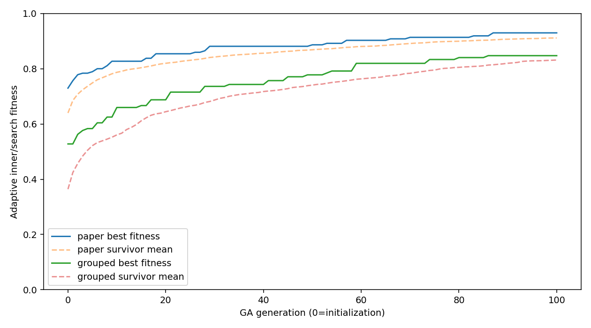
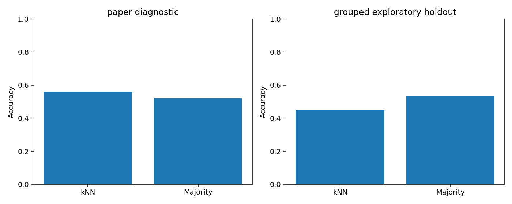
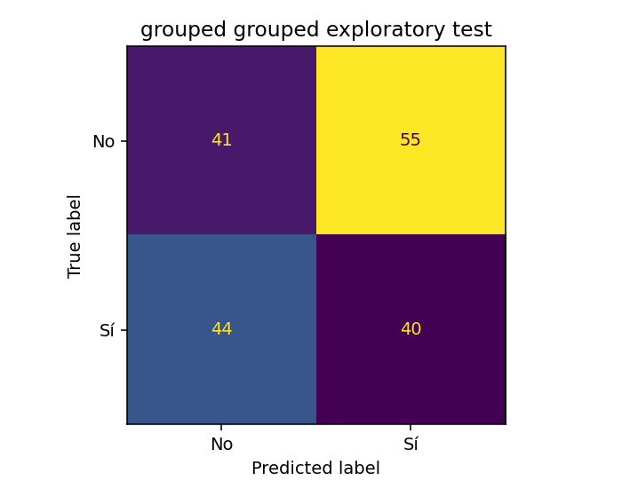
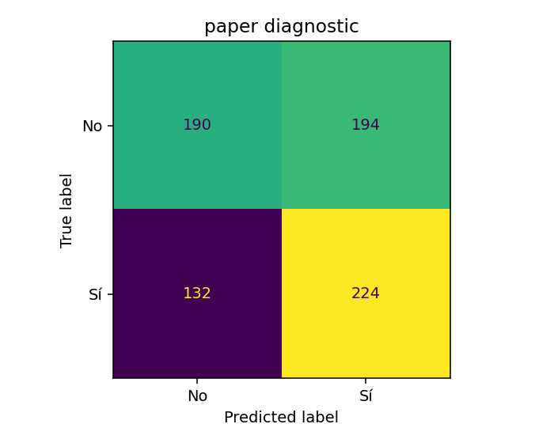

# Full kNN searches: paper-style and grouped evaluation

Each search used population **100** and **100 generations**, plus initialization. All values were measured and independently verified.

| Protocol | Search fitness | Final accuracy | Macro-F1 | Majority accuracy | k | Evaluation windows |
|---|---:|---:|---:|---:|---:|---:|
| paper | 92.97% | 55.95% | 0.5585 | 51.89% | 9 | 740 |
| grouped | 84.72% | 45.00% | 0.4500 | 53.33% | 7 | 180 |

The grouped result does not beat its training-majority baseline. This run does not demonstrate useful classification performance or an accuracy improvement.

The paper's reported 96% accuracy was not reproduced.

The paper-style result is a **diagnostic**, because EEG overlap and reuse of selection labels prevent independent validation. The grouped result keeps entire overlap components together and excludes the original 180-window holdout from its entire genetic search. That holdout was reported in earlier work, so this remains **exploratory**. Participant identifiers are unavailable; neither result establishes subject independence.

Both searches and their settings were declared before training. Both masks were frozen before any final predictions. The paper experiment uses the later 184/740 split and k=9; the grouped experiment uses 600 fitting and 144 fitness windows inside 744 training windows and the frozen 180-window test, with k selected on inner fitness. Seeds, normalization and feature settings were not chosen using final accuracy.

The feature bank is unchanged from the printed-equation functional run. It includes the disclosed conventional Higuchi alternative and within-example handling of 131 undefined raw Katz values. Exact author settings remain unavailable, and no unqualified numerical 1:1 claim is made.

The optimization only avoids computing medians for nonmissing features. Transforms were checked bit for bit against the reference implementation; actual sklearn prediction is still called independently for every k. The GA follows the same population/RNG transitions and writes an atomic checkpoint after every generation.

The primary saved checkpoint is the predeclared grouped model. The paper diagnostic score never determines which checkpoint is saved as the primary model.

## Replay

```bash
NUMBA_CACHE_DIR=/tmp/eegis-numba-paper MPLCONFIGDIR=/tmp/eegis-matplotlib-paper OMP_NUM_THREADS=4 OPENBLAS_NUM_THREADS=4 MKL_NUM_THREADS=4 .venv-paper/bin/python -u -m eegis.train_knn100
NUMBA_CACHE_DIR=/tmp/eegis-numba-paper OMP_NUM_THREADS=4 OPENBLAS_NUM_THREADS=4 MKL_NUM_THREADS=4 .venv-paper/bin/python -m eegis.verify_knn100
.venv-paper/bin/python -m eegis.report_knn100
```

The training command above resumes local generation checkpoints only when code/data/configuration hashes match. Use a different --out for a different experiment. Only kNN received full searches here; the other nine classifiers retain the earlier functional-test results.

A fresh clone excludes binary feature caches and model checkpoints. After installing the pinned Python 3.10 environment and extracting the dataset, rebuild features and train into new output directories:

```bash
NUMBA_CACHE_DIR=/tmp/eegis-numba-paper MPLCONFIGDIR=/tmp/eegis-matplotlib-paper OMP_NUM_THREADS=4 OPENBLAS_NUM_THREADS=4 MKL_NUM_THREADS=4 .venv-paper/bin/python -m eegis.paper_protocol --prepare-only --out artifacts_paper_method/features_replay
NUMBA_CACHE_DIR=/tmp/eegis-numba-paper OMP_NUM_THREADS=4 OPENBLAS_NUM_THREADS=4 MKL_NUM_THREADS=4 .venv-paper/bin/python -u -m eegis.train_knn100 --feature-run artifacts_paper_method/features_replay --out artifacts_paper_method/knn100_replay
NUMBA_CACHE_DIR=/tmp/eegis-numba-paper OMP_NUM_THREADS=4 OPENBLAS_NUM_THREADS=4 MKL_NUM_THREADS=4 .venv-paper/bin/python -m eegis.verify_knn100 --artifacts artifacts_paper_method/knn100_replay
.venv-paper/bin/python -m eegis.report_knn100 --artifacts artifacts_paper_method/knn100_replay
```

The output path is included in the frozen plan; a replay creates its own plan without altering the measured original.

Single raw-window prediction with the locally regenerated grouped model:

```bash
.venv-paper/bin/python -m eegis.predict_knn100 --artifacts artifacts_paper_method/knn100_replay "EEGIS - Electroencephalogram Imagined Speech dataset/raw/class_6/0.csv"
```








