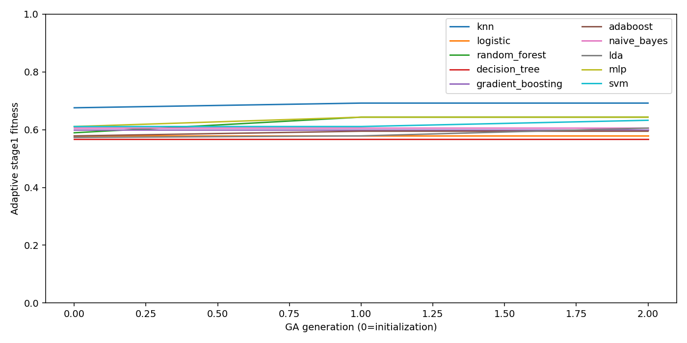
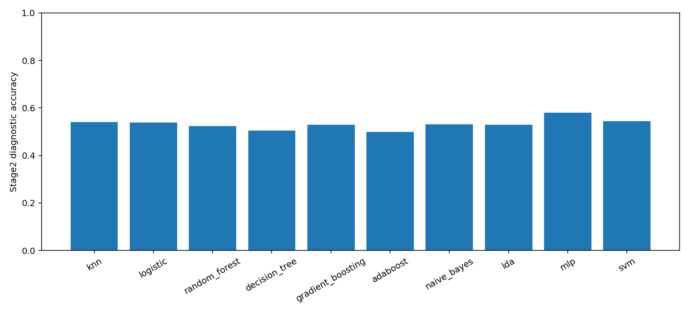

# Printed-paper feature and two-stage pipeline

This is a **small functional test**, not the full published experiment.

The run uses 2 GA generations plus initialization, 4 genomes, and 10 classifiers. All numbers below were measured and independently verified.

**Every reported score is diagnostic.** Random window splits share EEG samples, and the later evaluation reuses examples whose labels can already have influenced GA selection. These are not independent decoder accuracy estimates.

| Classifier | Stage1 GA fitness | Later 20/80 accuracy | Macro-F1 |
|---|---:|---:|---:|
| knn | 69.19% | 54.05% | 0.5393 |
| logistic | 57.84% | 53.92% | 0.5391 |
| random_forest | 64.32% | 52.30% | 0.5060 |
| decision_tree | 56.76% | 50.54% | 0.5031 |
| gradient_boosting | 60.00% | 52.97% | 0.5272 |
| adaboost | 59.46% | 49.86% | 0.4986 |
| naive_bayes | 60.54% | 53.11% | 0.5310 |
| lda | 60.54% | 52.97% | 0.5297 |
| mlp | 64.32% | 57.97% | 0.5796 |
| svm | 63.24% | 54.32% | 0.4998 |

Majority reference on the later split: **51.89%**. The saved model is **knn**, selected using stage1 fitness alone. No model was selected using the later accuracy.

## Method now implemented

- Only the original 480 No and 444 Sí one-second, 14-channel, 128 Hz examples are used.
- Raw EEG is filtered once into the five fourth-order Butterworth bands.
- The 14×214 bank follows printed CV, median-of-halves quartiles, Hjorth activity, Petrosian and Katz formulas.
- Relative band power uses the original raw spectrum as context. Band amplitude uses the already filtered signal and its time derivative, without a second band filter.
- Each classifier has its own 228-bit electrode/feature GA. All ten sklearn estimators retain their default parameters; kNN searches all seven published k values independently.
- Stage1 fits on739 windows and uses185 for GA fitness. There is no additional inner split.
- Every selected genome is frozen before stage2. The later experiment fits on184 windows and evaluates740; kNN uses k=9 as stated for that stage in Section3.
- Standard accuracy, macro-F1, per-class metrics, confusion matrices, convergence graphs and checkpoints are saved. The paper’s printed precision formula is recorded separately from standard precision.

## Limits of literal reproduction

Literal Higuchi equations A22–A24 were undefined in **18 of 24 declared real EEG checks**, because signed curve lengths are nonpositive before taking logarithms. The strict-literal mode records this and stops without training. This runnable experiment explicitly selects **conventional Higuchi**.

There are **131 undefined values** in the base feature bank, with per-column counts in undefined_features.csv. The selected policy is **median**. Within-window imputation uses only electrodes from that example; a completely missing feature column receives zero. The optional train-population mode fits imputation and scaling only on fitting examples.

The paper does not provide the exact seed, split indices, GA probabilities, normalization axis, complete spectral/recurrence configuration or missing-value policy. These choices are recorded in plan.json and feature_spec.json. This is an executable reconstruction of the stated workflow; it is not proof of a numerical 1:1 replica of the unpublished author program.

## Reproduce

Use the existing pinned Python 3.10 environment (.venv-paper). No new dependencies are required.

```bash
NUMBA_CACHE_DIR=/tmp/eegis-numba-paper MPLCONFIGDIR=/tmp/eegis-matplotlib-paper OMP_NUM_THREADS=4 OPENBLAS_NUM_THREADS=4 MKL_NUM_THREADS=4 .venv-paper/bin/python -u -m eegis.paper_protocol --generations 2 --population 4 --out artifacts_paper_method/smoke_replay
NUMBA_CACHE_DIR=/tmp/eegis-numba-paper OMP_NUM_THREADS=4 OPENBLAS_NUM_THREADS=4 MKL_NUM_THREADS=4 .venv-paper/bin/python -m eegis.verify_paper_protocol --artifacts artifacts_paper_method/smoke_replay
.venv-paper/bin/python -m eegis.report_paper_protocol --artifacts artifacts_paper_method/smoke_replay
```

The default command below runs all ten classifiers with population100 and100 generations in a separate output directory. It can take substantially longer than the functional test.

```bash
NUMBA_CACHE_DIR=/tmp/eegis-numba-paper MPLCONFIGDIR=/tmp/eegis-matplotlib-paper OMP_NUM_THREADS=4 OPENBLAS_NUM_THREADS=4 MKL_NUM_THREADS=4 .venv-paper/bin/python -u -m eegis.paper_protocol
```

Use --resume with the same code and configuration to resume saved classifier searches. The full 100-generation run has not been executed unless results.json states full_100_generation_study=true.

Strict literal check:

```bash
NUMBA_CACHE_DIR=/tmp/eegis-numba-paper .venv-paper/bin/python -m eegis.paper_protocol --strict-literal --prepare-only --out artifacts_paper_method/literal_check
```

This command is expected to stop with the mathematical-domain diagnostic; it does not silently replace Higuchi.

Single raw-window prediction:

```bash
.venv-paper/bin/python -m eegis.predict_paper_protocol "EEGIS - Electroencephalogram Imagined Speech dataset/raw/class_8/0.csv"
```

The reference runner uses CPU sklearn defaults. Earlier CUDA-capable alternatives remain available; no GPU execution or exact CUDA tie parity is claimed here.





Feature caches, checkpoints and population arrays stay local. Source, plans, manifests, measured scores, predictions, graphs and verification receipts can be shared.

## Checkpoint provenance

A CLI serialization reference was repaired after training. Original code snapshots, the original plan and original checkpoints are retained. All numerical code outside the CLI guard is AST-identical, and every prediction was unchanged before/after repair. The verifier checks the documented migration as well as independently refitting all models. See checkpoint_migration.json. Future CLI checkpoints use a canonical importable module.
