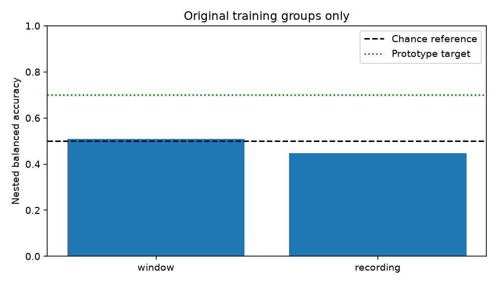
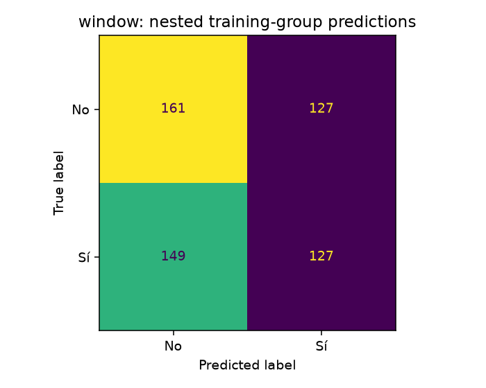
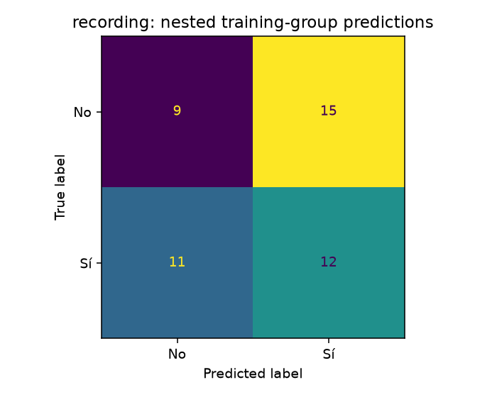

# Verified binary accuracy research

This batch compares 17 model families with 49 hyperparameter configurations per inner search. Only the original training partition is used. All results below were measured and independently verified.

| Decision | Accuracy | Balanced accuracy | Macro-F1 | Approximate balanced-accuracy 95% interval |
|---|---:|---:|---:|---:|
| 1 seconds | 51.06% | 50.96% | 0.5089 | 42.53%–59.40% |
| 7.875 seconds | 44.68% | 44.84% | 0.4445 | 30.98%–59.27% |

The initial prototype gate requires at least 70% balanced accuracy and 0.70 macro-F1, with the approximate lower interval above chance. **This batch does not meet that gate.**

These scores estimate the complete inner-selection procedure, not the performance of one fixed classifier. Five outer folds keep complete overlap groups separate. Three inner folds select the representation, feature selector, scalers and classifier using only each outer fitting partition. The final exported model is selected by a separate three-fold search over all original training groups, without using outer scores to pick its parameters. The original validation and test partitions were not evaluated by this batch.

There are only **47 original training overlap components**: 564 correlated one-second windows, or 47 reconstructed components of 1,008 samples each. The two decision durations differ and cannot be reported as interchangeable accuracy measurements. Chance balanced accuracy is 50% for two classes.

The saved field independent_overlap_groups counts components with disjoint observed samples. It does not certify independence of participants, sessions or complete experimental trials.

Every EEGIS example appeared in earlier project analyses. These follow-ups are exploratory, including repeated use of training folds while developing later batches. No verified participant IDs exist in the release, and no subject-independent or deployment-quality claim is made. The paired overlap-group bootstrap describes variation in saved out-of-fold predictions; it does not account for every adaptive research choice or all dependence caused by overlapping CV training sets.

Verification independently refits five selected outer models and 15 selected inner models per decision duration, checks exact predictions and all reported metrics, audits all group boundaries, and verifies raw versus cached inference and the final exported model. All stored candidate-score tables are checked for selection consistency; every candidate fit is not independently repeated.

Final models and feature caches stay local. Recreate them with the matching training module and run `python -m eegis.verify_accuracy --artifacts artifacts_pretrained` before reporting results. The frozen plan records source/data/runtime hashes and every candidate.

