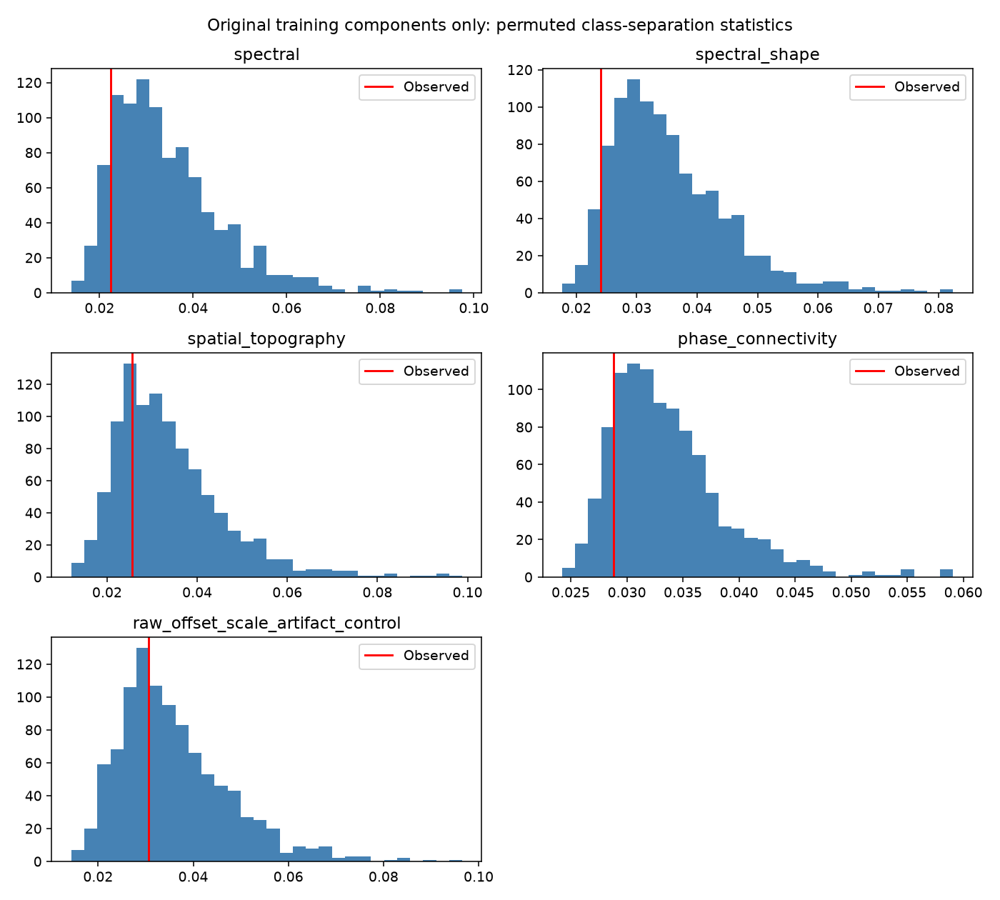

# Training-only class-separation diagnostic

Five fixed representations were tested using a biased RBF-kernel mean-distance statistic with median-distance bandwidth, 999 class-label permutations and Holm correction. Only the original 47 training overlap components were used; no original validation/test examples enter this diagnostic.

Raw permutation p-values range from 0.620 to 0.941. All five Holm-adjusted p-values are 1.0. These representations did not show statistically detectable class separation in this small exploratory check. This does not prove that EEGIS contains no information, that labels are wrong, or that a particular accuracy is impossible. The sample is limited and the research history is adaptive.

This is not a classifier accuracy measurement. Components have disjoint observed overlap but are not verified independent participants or complete trials. The diagnostic includes raw offset/scale as a recording-artifact control, alongside spectral, topographic and phase features.

An independent direct kernel-mean calculation and all 999 permutation p-values match the saved results. See verification.json, results.json and class_separation.csv. Reproduce with `.venv/bin/python -m eegis.data_signal_audit`.

